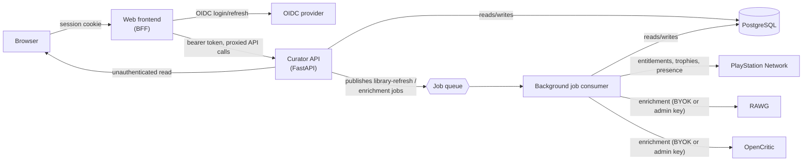
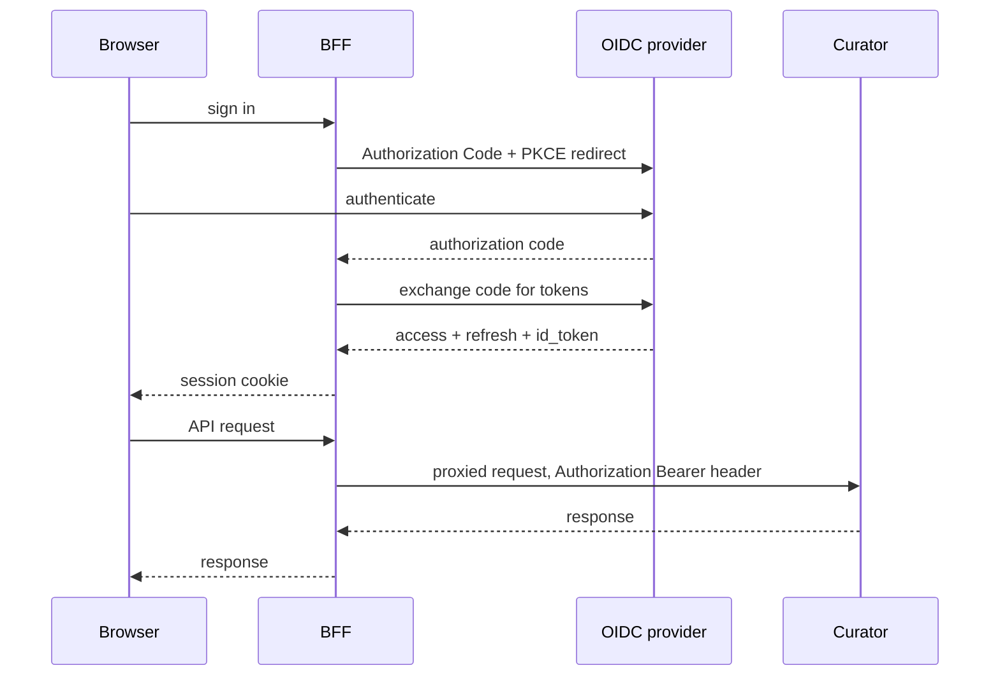
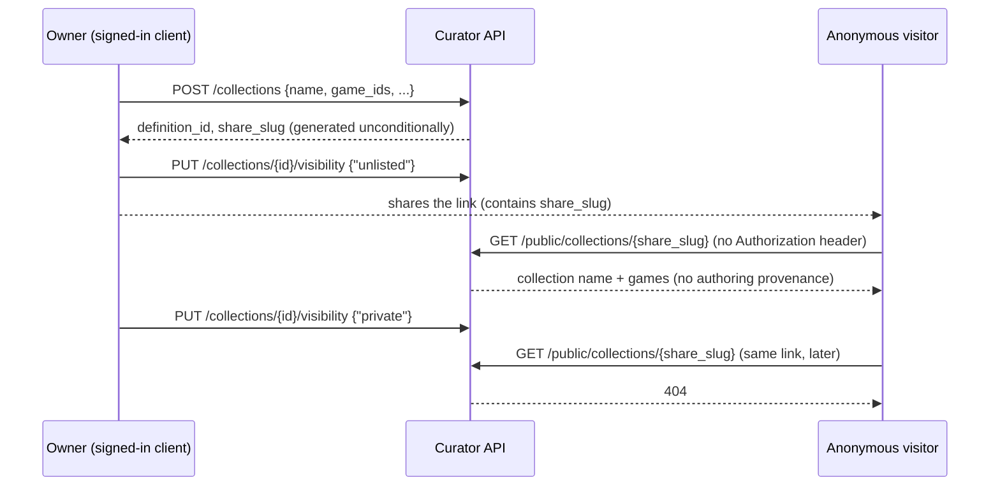
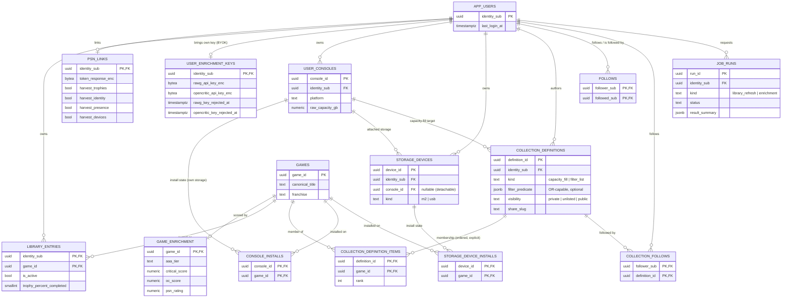
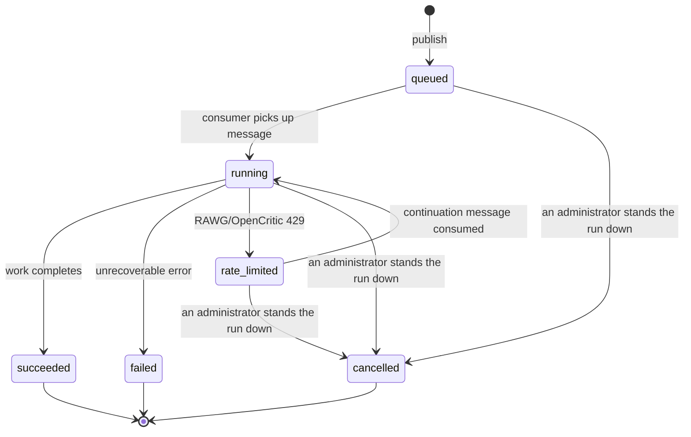

# Architecture

Curator is a PlayStation game-curation API. A user links their PlayStation Network (PSN) account, imports
their entitlements (owned games), and builds named **collections** from them — explicit, ordered lists a
user curates and can optionally share via a public link. Its client is a web frontend whose
Backend-for-Frontend (BFF) holds the user's session; the frontend never calls PSN, RAWG, or OpenCritic
itself. Those calls come from two places only: this API, for anything a user is waiting on, and a separate
background job consumer, for the long-running imports and enrichment passes it picks up off the job queue.

## Bird's-eye view



The last edge covers the three routes that take no `Authorization` header at all:
`GET /public/collections/{share_slug}`, serving a collection's public share link to anyone with the link,
and `GET /catalog/games` / `GET /catalog/games/{gameId}`, the shared game catalog. The catalog is public
content with no per-user data in it, and a frontend may publish a sitemap covering every game's detail
page, so those two routes have to answer without a session for the pages to be indexable at all.

## Codemap

| Path | What it does |
|---|---|
| `src/curator/app.py`, `settings.py`, `deps.py`, `token_validation.py` | The app factory, settings, and the bearer-token gate every route depends on |
| `src/curator/*_routes.py` | One module per route group; route docstrings are the published OpenAPI descriptions |
| `src/curator/psn/` | The PSN client: npsso auth and session, trophies, social, presence, the storefront, the shared rate limiter |
| `src/curator/catalog/`, `library/`, `collections/`, `scoring/`, `enrichment/` | The shared catalog and store walks, per-user libraries, collection strategies, ranking and size estimation, the RAWG and OpenCritic key validators |
| `src/curator/jobs/` | Queue publishing, `job_runs` status, the queue-depth monitor and the PS Plus walk scheduler |
| `src/curator/persistence/`, `audit/` | Settings resolution, the database URL, `TokenCrypto`, the data-access classes, and the account action log |
| `src/curator/telemetry.py` | OTLP traces and metrics, Elasticsearch logging |
| `db/migrations/`, `db/run_migrations.py`, `db/reencrypt_tokens.py` | The schema, its runner, and the secrets-at-rest verifier |
| `tests/` | The offline suite plus the gated `tests/test_schema.py` |
| `app.py`, `dev_server.py` | The App Service entry point and the local one |

## Sign-in

The BFF holds the OIDC session; the browser never sees a token. Curator sees only the bearer token the BFF
forwards.



Curator answers a missing or invalid token with 401 and `WWW-Authenticate: Bearer`, and an unreachable
OIDC provider with 503 and no `WWW-Authenticate` header, so a client that refreshes its token on a 401 does
not refresh against a provider that is down.

## Library refresh, with rate-limit continuation

`POST /library/refresh` returns immediately with a `run_id`; the actual work happens off the request path
so a large library (PSN allows no batch entitlement endpoint) never ties up an HTTP connection.

```mermaid
sequenceDiagram
    participant Client
    participant Curator as Curator API
    participant Queue as Job queue
    participant Worker as Job consumer
    participant DB as PostgreSQL
    participant PSN
    participant RAWG as RAWG / OpenCritic

    Client->>Curator: POST /library/refresh
    Curator->>DB: INSERT job_runs (status=queued)
    Curator->>Queue: publish library-refresh message
    Curator-->>Client: 202 {run_id}

    Queue->>Worker: deliver message
    Worker->>DB: claim the run -- compare-and-swap on (run_id, seq), skipping stale redeliveries
    Worker->>PSN: fetch entitlements
    Worker->>DB: canonicalize + upsert library_entries/games (commits before enrichment)
    loop each game
        Worker->>RAWG: enrich, using this user's own key
        alt key rejected (401/403)
            Worker->>Worker: disable that provider for the rest of this run, retry the same game
            Worker->>DB: record the rejected key + an audit log entry
        else rate limited (429)
            Worker->>DB: job_runs -> rate_limited, seq bumped, result_summary so far
            Worker->>Queue: schedule continuation message (backoff)
            Note over Worker,Queue: run pauses here; resumes from the same point later
        end
    end
    Worker->>PSN: match + fetch trophy completion
    Worker->>DB: job_runs -> succeeded, with the merged result_summary

    Client->>Curator: GET /library/refresh/{run_id} (polled)
    Curator-->>Client: status + result_summary
```

Entitlement ingestion commits before enrichment runs, so a rejected key, a rate limit, or a transient
network error during enrichment costs a user enrichment signal and trophy-match data for that pass — never
the underlying library import itself.

`job_runs.seq` is a checkpoint counter, bumped every time a pause is recorded and stamped into that pause's
continuation message. The worker claims a message with a compare-and-swap on `(run_id, seq)`: a message
redelivered after its own settlement failed (e.g. a Service Bus lock lapsing mid-run) carries a `seq` that a
later checkpoint has already superseded, so the guard settles it without reprocessing instead of restarting
the whole batch. The consumer also holds a lease on the row and renews it while it works, so a run that has
stopped being renewed is distinguishable from one still in flight.

## Collection sharing



An unknown `share_slug` and a `"private"` collection's `share_slug` are deliberately indistinguishable —
both 404. A collection that was shared and later made private stops working exactly like one that never
existed; there is no separate "revoked" state to fall out of sync with `visibility`.

## Data model

Scoped to the entities a user or a collaborating repo actually interacts with. Not shown: pure lookup and
provider/contributor-cache tables (`genres`, `publisher_tiers`, `franchise_rules`, `edition_ranks`,
`size_estimates`, `rawg_cache`, `opencritic_cache`, `psn_catalog_cache`,
`global_exclusions`, `game_download_sizes`, `ps_plus_catalog_categories`, `ps_plus_catalog_walks`,
`ps_plus_catalog_memberships`,
`game_name_overrides`, `curation_rule_pass_state`, `game_measured_sizes` (a global, upserted install-size
cache any signed-in user may contribute to) and audit/history tables (`account_action_log`, `entitlement_pulls`,
`entitlement_snapshots`, `collection_runs`, `collection_items`).



A collection's membership (`collection_definition_items`) is explicit and stored — never a live query. Two
tables carry `genre_filter`/`min_score`/`aaa_tier_filter`/`filter_predicate` as **provenance only**: they
record how a collection was first assembled (and let its owner ask for a fresh proposal), but nothing ever
re-evaluates them to decide what's actually in the collection.

## PlayStation platforms

`platforms` is the reference table and the vocabulary: PS5, PS4, PS3, PSVITA, PSP, PS2, PS1, ordered
newest-first by `sort_order`. `user_consoles`, `game_measured_sizes`, `size_estimates` and
`library_entry_platforms` all point at it by foreign key. `curator.psn.title_platform.CONSOLE_PLATFORM_IDS`
is the Python mirror, held to the table by a test in `tests/test_schema.py` rather than by convention —
a `Literal` cannot be built at runtime, so the alternative is a route that rejects a platform the schema
accepts, with nothing going red.

**Ownership is a set, not a scalar, and `library_entry_platforms` is the only place it lives.** One game
can be owned on several platforms at once (PS4 and PS5 most often), which no single column can express.
The candidate query for a collection, the platform list on `GET /library`, and the manual-add write path
all read or write `library_entry_platforms`, and the background worker reconciles it on every ingestion.

**A legacy entitlement's platform comes from its title-id prefix.** PSN returns `entitlementAttributes[]`,
and therefore a `platformId`, only for PS4 and PS5 titles; for older titles the only per-platform signal is
the title id: `BLUS`/`BCUS` and friends are PS3, `PCSA`–`PCSH` are Vita, `UCUS`/`ULUS` are PSP.
`title_platform` also classifies the prefixes that are not titles at all: `SUBC`, `SCEA` and `NPIA` are PS
Plus SKUs and their reward children ("100% Discount Off"), `NPUP`/`NPUK` are video apps and PlayStation
Home themes. `NPIA` reads like a PS3 prefix and is not one. The background worker classifies prefixes
during ingestion with the same map, so a change to one is a change to both.

## Three PlayStation identifiers, and which of them join

PSN issues three different ids for what a person would call one game, and the catalog keys on a different
one in each table. Passing one where another is required fails silently: PSN answers `200` with an empty
match rather than an error, so the mistake shows up only as blank data.

| Identifier | Shape | Where the catalog holds it |
|---|---|---|
| Concept id | `201930`, `10003543` — bare digits | `game_concepts.concept_id` (primary key) |
| Product id | `UP1004-PPSA03420_00-GTAOSTANDALONE01` — three dash-separated segments | `game_concepts.product_id`, `psn_catalog_cache.store_product_id`, `entitlement_snapshots.product_id` |
| npTitleId | `PPSA03420_00`, `CUSA13505_00` | `psn_catalog_cache.title_id` (primary key), `library_entries.title_id` |

A **concept** is the game; a **product** is one purchasable edition of it; an **npTitleId** is one
installable title. One concept has many products and many title ids.

**The middle segment of a product id is not a reliable npTitleId, and must never be used as one.** It
looks like one, and for a storefront product node it matches the node's own `npTitleId`. But a product
routinely covers a *different* title from the one an entitlement grants: a PS5 (`PPSA`) product granting a
PS4 (`CUSA`) title, or a PS Plus subscription SKU (`IP9101-PPSA06916_00-PLUS2T12M0000000`) granting
`NPIA90007_01`. Splitting the string produces a plausible-looking wrong value, which PSN answers with an
empty match.

**PSN's universal search returns the first two ids and never the third.** A `MobileGames` hit is a
`Concept` whose `result.id` is the concept id; its `defaultProduct.id` is a product id. So a search hit
joins to `game_concepts` and cannot be written into `psn_catalog_cache` at all — which is why
`POST /library/manual`'s store-hit branch creates `games`, `game_concepts` and `game_enrichment` rows and
stops there. Recovering the npTitleId would need a concept-to-titles lookup; the only catalog endpoint
either PSN client library exposes is `catalog/v2/titles/{npTitleId}/concepts`, which runs the other way.

**`defaultProduct` is merchandising, not identity.** It drifts: one concept can point at a bundle product
one day and a standalone product the next. It is stored as the concept's current store link and nothing
keys on it. Product ids are not unique either: two genuinely different games can share one, so a merge on
product id additionally requires the names to agree.

**A store-admitted game therefore keeps its cover in a column of its own.** Cover art normally resolves
from `entitlement_snapshots`, which only a library refresh writes, and the one other place a URL could
live — `psn_catalog_cache.cover_image_url` — is in the table this path cannot key. The search hit does
carry usable art, so `0057` gives `games` a `store_cover_image_url` that admission fills from the hit and
the shared cover expression falls back to when there is no entitlement artwork. **Entitlement art comes
first**, so a game that already renders art is unaffected. Admission is the only chance to keep that URL:
nothing running later can re-fetch what admission discards. A game with neither source still renders
without artwork, which is an expected state — PSN publishes none at all for much of the PS3/Vita/PSP back
catalogue.

## Job lifecycle

`job_runs.status` drives both `library_refresh` and `enrichment` jobs identically.



`rate_limited` is not an error — it is an expected, self-resolving pause. The same `run_id` is republished
to a continuation queue once the provider's limit is expected to have lifted, and `result_summary` merges
across every resume so the run's final report describes the whole job, not just its last leg. A run can
cycle through `rate_limited` → `running` more than once before reaching a terminal state.

`cancelled` is the remedy for a run that will never move again (its queue message was never delivered, or
the worker was down when it was published). Without it, `POST /enrichment/runs` would keep returning the
stuck run's id until 24 hours of staleness passed. It is a status rather than a row deletion because `job_runs` is the audit trail the lease reaper and every operator query
read; it is distinct from `failed` because nobody attempted the work and nothing broke.

**Three statuses are terminal, and that number is the thing to check when adding a fourth.** Every
"is this run still active" predicate in both this repo and the worker is written as the complement of the
terminal set, so a new terminal status that is not added to all of them reads as permanently active — which
is the exact failure `cancelled` exists to fix. `curator.jobs.repository.TERMINAL_STATUSES` is this side's
single copy.

## Enrichment: a user's own key, or the shared cache

Every user may configure their own RAWG/OpenCritic API key (`user_enrichment_keys`, encrypted at rest), and
a user's own refresh spends only that key. Without a RAWG key a refresh makes no RAWG calls at all. Without
an OpenCritic key it still matches against the shared `opencritic_cache` — only extending that cache with
freshly fetched pages needs a key of its own.

Admin-held keys are used in two places, neither of them a user's refresh: the catalog-wide enrichment run
and the nightly OpenCritic cache sweep. Both fill the shared caches every user's refresh then reads from,
which is what keeps enrichment useful for a user who has brought no key.

A key that a provider rejects (401/403) disables *only that provider* for the rest of the run — the run
still reaches `succeeded`, `result_summary.rejected_providers` records what was skipped, and the rejection
is persisted (`rawg_key_rejected_at`/`opencritic_key_rejected_at`) so
a client can prompt the owner to re-enter a dead key without them discovering it via a string of quietly
degraded refreshes.

## Auth model

Curator never issues tokens, never redirects a browser through a login flow, and holds no session or
cookie; there is no OIDC client registration in this codebase. Every caller presents
`Authorization: Bearer <token>`. The OIDC provider issues JWT access tokens for a `curator` API scope that
carries the user's `email` claim; `sub` identifies the user. `curator.token_validation.JwtValidator`
validates every presented token:

- RS256 signature, pinned rather than read from the token, verified against the provider's JWKS (from
  `{OIDC_AUTHORITY}/.well-known/openid-configuration`, cached, and refetched once on a signature failure to
  cover key rotation)
- `iss` equals the configured authority
- `exp`/`nbf`
- `curator` present in the `scope` claim (a JSON array, or a space-delimited string)

**Audience is not validated**: the provider issues these tokens with no Curator-specific audience.

`curator.deps.require_bearer` gates every protected route: 401 with `WWW-Authenticate: Bearer` on a
missing, malformed or invalid token, 403 without the `curator` scope, and 503 with no `WWW-Authenticate`
header when the provider's discovery document or JWKS cannot be fetched. Routes that compare emails
(`/me`'s re-verify, `POST`/`DELETE /psn/link`) also depend on `require_verified_caller`, which answers 403
for a token without an `email` claim. Admin routes depend on `require_admin`, which requires the
`curator.admin` claim. `optional_bearer` serves the anonymous catalog routes: no header is anonymous, and a
supplied but invalid token is still rejected rather than downgraded.

PSN data harvesting is gated per user as well: `psn_links` carries four opt-in flags (`harvest_trophies`,
`harvest_identity`, `harvest_presence`, `harvest_devices`), all `false` by default and set only by the
linked user through `PUT /me/psn-preferences`. `curator.deps.require_preference` answers 404 when the caller
has no PSN link and 403 when that category's flag is off, before any PSN call, so the API enforces it and not
only a UI toggle.

## Social profile

Every user has a profile, keyed by `sub`, that other users can view and follow. A profile is **private by
default** (`user_profiles.is_public = false`); a missing row behaves as a private profile with every toggle
off, not as a 404.

The owner controls four display toggles: `show_library`, `show_collections`, `show_trophies`,
`show_identity`. `show_library`/`show_collections` also require `is_public`; `show_trophies`/`show_identity`
require `is_public` **and** the matching harvest flag, so a user opts in twice, once to harvest and once to
show, before a stranger sees PSN data. The owner always sees their own sections, governed by their own
`show_*`/`harvest_*` settings; `is_public` governs only what other viewers see.

An owner may declare their handle on other PlayStation sites. Each is stored as a site key plus a handle,
never a URL: the sites are an allowlist (`profile_link_sites`, seeded by
`db/migrations/0042_user_profile_links.sql`), the `href` is built from the site's own `url_template`, and
the handle is constrained to `[A-Za-z0-9_-]{3,16}` by both the API and a CHECK constraint, so a stored value
can never carry a `javascript:` scheme or an off-allowlist host into an anchor.

Following is a first-party directed graph (`follows`), unrelated to PSN, and follow/unfollow is idempotent.
**Follower and following lists are always visible, public profile or not**: they are Curator's own data, so a
private profile still takes part in the social graph while exposing nothing PSN-derived or curation-derived.

## Invariants

The privacy and security rules the code holds, each pinned by tests:

- **Linking a PSN account trades a wider credential for per-user throughput.** Each user supplies their own
  npsso, broad enough to mint the same session tokens the official PlayStation App uses, so a user's
  throughput is bounded by their own account rather than a shared service account's queue. The schema earns
  the safety back: the npsso is used once and never persisted or logged, no column named like an email
  exists anywhere in the schema, and every stored token is AES-256-GCM-encrypted at rest.
- **Every use of a person's PSN token is recorded before it happens.** `curator.audit.recorded` writes an
  `account_action_log` row with outcome `started`, runs the call, then marks the row `completed` or
  `failed`; a row that cannot be written stops the call before the token is touched.
- **`PUT /me/enrichment-keys/{provider}` validates the key against the real provider before persisting**
  (RAWG `GET /genres?page_size=1`; OpenCritic one page of its catalog listing, never search). A rejected key
  is 400 and an unreachable provider 503; neither is written.
- **Per-user provider keys use the same AES-256-GCM key as PSN tokens** (`TokenCrypto`, keyed by
  `CURATOR_TOKEN_KEY`). No route returns a key value.
- **A user's key is never exposed, but the game metadata it retrieves is shared**: titles, genres and scores
  are written to the shared `rawg_cache`/`opencritic_cache` so later lookups need no provider call. A client
  should disclose this to its users.
- **No display-name field exists**, so there is nothing free-text to sanitize or moderate; a profile shows
  its PSN account id when linked and shown, else "Unlinked user".
- **Region is structurally absent from the profile identity response**: PSN exposes an account's region
  only to that account, so it is meaningless for a cross-user lookup.
- **Cross-user PSN lookups always use the viewer's own token.** When B views A's public profile, Curator
  calls PSN with B's token and A's `psn_account_id`; A's stored token is never used on B's behalf. When B has
  no link or PSN rejects B's token, those sections are omitted rather than failing the page.
- **Self-follow is rejected at both layers**: a `follows_no_self_follow` CHECK, and a route check that
  answers 400 first.
- **A secret in a URL query parameter leaks unless every sink is closed.** RAWG takes its key as `?key=`,
  so three guards apply together: `RawgApiError` re-raises `from None` with a sanitized message, so the
  original exception (whose message embeds the URL) never reaches a log; `RawgKeyRedactingSpanProcessor`
  strips `key` from httpx span attributes as the span starts, since OpenTelemetry's own redaction covers a
  fixed list that does not include it; and the worker that writes `job_runs.error` maps every exception to
  short category text, so `GET /library/refresh/{run_id}` can never echo one.

## Boundaries

- **The OIDC provider** issues the access tokens; Curator reads only its discovery document and JWKS.
- **PostgreSQL** is shared with the background job consumer, which reads and writes the same schema. Curator owns
  the schema: every migration lives in `db/migrations/`.
- **Azure Service Bus**: Curator publishes to `curator-library-refresh`, `curator-enrichment` and, as scheduled
  messages, `curator-scheduled-refresh` (`src/curator/jobs/queue_publisher.py`), and consumes nothing; it reads the
  depth of those queues and of `curator-library-refresh-continuation` for metrics.
- **Redis** holds the trophy-read cache and the PSN rate limiter shared with the job consumer.
- **PlayStation Network**: the mobile gateway with the user's own token, and the anonymous storefront gateway whose
  endpoint and query hashes are configuration.
- **RAWG and OpenCritic** are called here only to validate a user's key before it is stored; enrichment itself runs
  in the job consumer.

## Cross-cutting concerns

Configuration resolves every setting from an explicit argument, then the environment, then `.env`, and a missing
required setting stops startup (`src/curator/persistence/config.py`, `src/curator/settings.py`).

### Telemetry

`curator.telemetry.configure_telemetry` wires two legs at the end of `create_app`:

- **Traces and metrics** over OTLP gRPC to `AlloyEndpoint`, with `service.name` `crgolden-curator`. FastAPI,
  psycopg and outbound httpx calls are instrumented; `/health` is excluded.
- **Structured logs** to Elasticsearch at `ElasticsearchNode` with `ElasticsearchUsername`/
  `ElasticsearchPassword`, written with `op_type="create"` into the `logs-app-curator` data stream, so the
  built-in `logs` index template and its lifecycle policy apply. Each document carries a flat `log.level`
  in .NET's vocabulary (`Information`, `Warning`, `Error`) so it queries alongside .NET services' logs, and
  only `WARNING` and above ships. A `QueueHandler`/`QueueListener` thread does the write, so a slow
  Elasticsearch never blocks a request.

On App Service (`WEBSITE_SITE_NAME` present) both legs are required; elsewhere each is off unless its
settings are present, and a configured `ElasticsearchNode` still needs both credentials. **A leg that fails
to configure raises and stops startup.** Once running, a failure to ship a log record is counted and
written to stderr, never raised. Process-wide state (the providers, the instrumentors, the log handler) is
registered once per process, so repeated `create_app` calls never stack a second provider.
